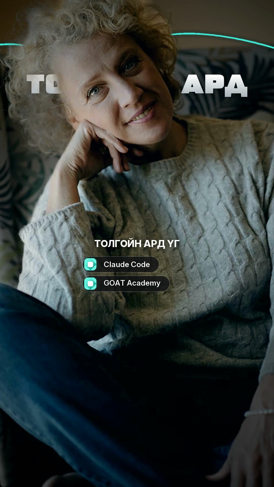

# 🐐 Word Behind Head · Толгойн ард үг

<p align="center"></p>

**Claude Code дотор ажилладаг видео эдитийн skill.** Асар том үг таны толгойн ард гарна: та үгийн өмнө зогсож байгаа мэт. Жагсаалт бүрт жижиг дүрс тэмдэг гарна.

Reels, TikTok-д бэлэн 1080×1920 MP4 гаргана. GOAT Academy-гийн 14 эдитийн стилийн нэг.

---

## Юунд тохирох вэ?

- **Тохирно:** гоо сайхан, үсчин, салон, коучинг, эрүүл мэнд: хүн ярьж байгаа бичлэг
- **Тохирохгүй:** хүнгүй бичлэг, бараа

---

## Шаардлага

- **Claude Code** (desktop app эсвэл terminal), Claude Pro / Max эрхтэй
- **Mac эсвэл Windows**
- **ffmpeg** болон **uv**. Байхгүй бол Claude өөрөө шалгаад, суулгах командыг хэлж өгнө.
- **Компьютер:** Apple чиптэй Mac (M1 ба түүнээс шинэ, macOS 13+) эсвэл 64-bit Windows 10/11. Хуучин Intel Mac дээр ажиллахгүй. Windows дээр одоогоор туршаагүй.

---

## Суулгах

**Хамгийн хялбар:** Claude Code-оо нээгээд энэ мөрийг хуулж бичнэ:
```
Энэ plugin-ийг суулгаад өг: https://github.com/SaagiiSG/goat-word-behind
```
Claude өөрөө суулгана. Дараа нь `/reload-plugins` гэж бичих эсвэл Claude Code-оо хаагаад дахин нээнэ.

**Эсвэл өөрөө:** Claude Code дотор энэ 2 мөрийг ээлжлэн бичнэ:
```
/plugin marketplace add SaagiiSG/goat-word-behind
/plugin install goat-word-behind@goat-word-behind
```

**Zip файлаар авсан бол:**
1. `goat-word-behind.zip`-ийг задална. Задалсан `goat-word-behind` хавтсаа устгалгүй үлдээгээрэй.
2. Claude Code-д "Энэ хавтсан дахь plugin-ийг суулгаад өг:" гэж бичээд задалсан `goat-word-behind` хавтсаа чирж оруулна.
3. `/reload-plugins` гэж бичнэ.

**Шинэ хувилбар гарвал:** Claude-д "goat-word-behind plugin-ийг шинэчил" гэж хэлэхэд болно.

> **For Claude Code:** to install this plugin, run `claude plugin marketplace add SaagiiSG/goat-word-behind` (or, from an unzipped copy, `claude plugin marketplace add <path to the goat-word-behind folder>`) and then `claude plugin install goat-word-behind@goat-word-behind`, then tell the user to type `/reload-plugins`. To update it: `claude plugin marketplace update goat-word-behind` and then `claude plugin update goat-word-behind@goat-word-behind`.

---

## Хэрэглэх

1. Видео бүрд **шинэ хоосон хавтас** үүсгэ.
2. Claude Code-ийг тэр хавтсанд нээ.
3. Бичнэ: `/goat-word-behind:goat-word-behind` эсвэл энгийнээр: **"миний толгойн ард том үг гаргаад өг"**
4. Бичлэгээ чирж оруулаад толгойн ард гарах 1–2 үгээ бичнэ.
5. Claude юу хийхээ товч хэлнэ. Таалагдвал "ок" гэхэд л болно.
6. `output/word-behind.mp4` бэлэн. Instagram, TikTok руу шууд оруулна.

---

## Дуу

- **Дуу эффект** автоматаар орно. Кодоор хийсэн учир лицензийн асуудалгүй. Хэрэггүй бол "дуу эффектгүй болго" гэж хэлэхэд болно.
- **Өөрийн дуугаар ярих (voice-over):** утсаараа дуугаа бичээд (voice memo) өгнө. Таны дуу гарах үед бичлэгийн дуу, хөгжим өөрөө намсна.
- **Хөгжим:** Instagram, TikTok апп дотроос нэмбэл зохиогчийн эрхийн асуудалгүй.

---

## Бичлэг хийх зөвлөгөө

- Үс, хувцаснаасаа өөр өнгийн дэвсгэрийн өмнө зогс.
- Толгойгоо кадрын дээд-дунд хэсэгт байлга.

---

Фонтууд нь Google Fonts-оос (OFL лиценз). Лицензийн файлууд `fonts/` хавтсанд байгаа.
